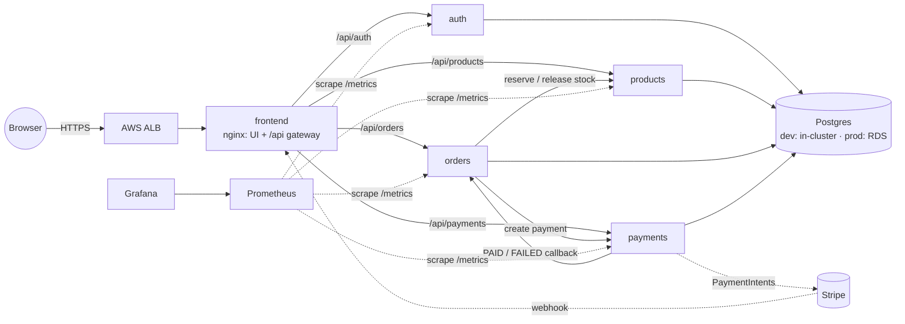
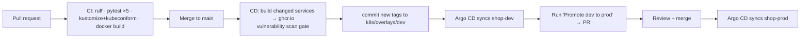

# Fieldkit Shop — Python microservices on EKS with GitOps

An online shop split into small Python (FastAPI) services, deployed to **Amazon EKS** with
**GitHub Actions → GitHub Container Registry (ghcr.io) → Argo CD**, and observed with **Prometheus + Grafana**.



| Service | Responsibility | Key endpoints |
|---|---|---|
| **auth** | Users, login, JWT issuing | `POST /register`, `POST /login`, `GET /me` |
| **products** | Catalogue + stock | `GET /products`, admin `POST/PATCH /products`, internal `reserve`/`release` |
| **orders** | Order lifecycle & state machine | `POST /orders`, `POST /orders/{id}/checkout`, `/cancel` |
| **payments** | Payment gateway (Stripe or mock) | `POST /payments/{id}/confirm` (mock), `POST /webhooks/stripe` |
| **frontend** | Storefront UI + API gateway (nginx) | `/`, `/api/<service>/…` |

Every service exposes `/healthz`, `/readyz` (checks DB) and `/metrics`.

## How the pieces fit

**Login.** `auth` stores PBKDF2-SHA256 password hashes (600k iterations) and issues short-lived
HS256 JWTs. The other services verify tokens locally with the shared secret — no call to `auth`
per request. Failed logins are throttled per email in the service and per IP at nginx.

**Checkout and payment.**
1. `POST /orders` → orders asks products to **atomically reserve stock** (a conditional
   `UPDATE … WHERE stock >= qty`, all-or-nothing), then saves the order as `PENDING_PAYMENT`.
2. `POST /orders/{id}/checkout` → payments creates a payment attempt (idempotent per order, so
   double-clicking “Pay” never double-charges).
3. **Stripe mode:** the browser confirms the PaymentIntent with Stripe.js — card data never touches
   your servers. Stripe sends a signed webhook → payments verifies the signature → tells orders
   `PAID`/`PAYMENT_FAILED`. If orders is unreachable the webhook returns 503 so Stripe retries.
   **Mock mode:** `POST /payments/{id}/confirm` with a Stripe-style test card.
4. Orders enforces a state machine (`PENDING_PAYMENT → PAID | PAYMENT_FAILED | CANCELLED`);
   callbacks are idempotent. Cancelling releases stock.

Mock test cards: `4242 4242 4242 4242` succeeds · `4000 0000 0000 0002` declined ·
`4000 0000 0000 9995` insufficient funds. Dev runs the mock gateway; prod runs Stripe.

**Internal endpoints** (`/internal/*`) need an `X-Internal-Token`, are blocked at the nginx
gateway, and NetworkPolicies only let shop pods (and Prometheus) reach the APIs.

## Repository layout

```
services/<name>/        FastAPI app + tests per service
libs/shopcommon/        shared config, auth, DB, metrics, logging, app factory
frontend/               static storefront + nginx gateway config
docker/                 one Dockerfile for all Python services (ARG SERVICE)
k8s/base/               Deployments, Services, Ingress (ALB), NetworkPolicies,
                        db-init Job, ServiceMonitor, alerts, dashboard
k8s/overlays/dev/       shop-dev: in-cluster Postgres, mock payments
k8s/overlays/prod/      shop-prod: RDS, Stripe, HTTPS, 2+ replicas, HPA, PDB
argocd/apps/            gp3 StorageClass, kube-prometheus-stack, shop-dev, shop-prod
platform/               gp3 StorageClass, ClusterSecretStore, Grafana admin secret
infra/terraform/        bootstrap (S3 state) · persistent (passwords file in S3) · cluster (VPC, EKS, Argo CD)
scripts/                configure.sh (your details), infra.sh (setup / up / down / status)
.github/workflows/      ci.yml, cd.yml, promote.yml
```

## Delivery pipeline



- Images are pushed to **ghcr.io** with the built-in `GITHUB_TOKEN`, so GitHub needs no AWS credentials at all.
- Only services whose code changed are rebuilt (`dorny/paths-filter`). Changes in `libs/` rebuild all Python services.
- Image tags are `sha-<7 chars>` and are never rebuilt for the same commit, so a tag always means the same build.
- Git is the source of truth: Argo CD `selfHeal` reverts manual `kubectl` edits. Rollback = revert the commit.

## Infrastructure: what stays and what goes

Terraform is split so you can switch the expensive part off when you're not using it:

| Stack | Contains | Lifetime | Cost |
|---|---|---|---|
| `bootstrap` | S3 bucket holding Terraform state | permanent | pennies |
| `persistent` | `secrets/shop-secrets.json` in the same S3 bucket (generated passwords) | permanent | pennies |
| *(GitHub)* | source code + container images on ghcr.io | permanent | free for public repos |
| `cluster` | VPC + NAT, EKS, nodes, load balancer controller, Argo CD | **up/down daily** | ~£8–12/day while up |

Your **source code lives on GitHub** and is never touched by any of this. `down` destroys only
the `cluster` stack; `up` recreates it and Argo CD redeploys the same images from ghcr.io, with the same
passwords from the S3 file, which Terraform turns into Kubernetes Secrets on every `up`. (Dev's in-cluster Postgres is rebuilt empty each time: the catalogue
re-seeds itself, but test users/orders are gone. Use RDS if you need data to persist.)

## Setting it up

Prerequisites: `aws` CLI (logged in), `terraform` ≥ 1.10, `kubectl`, `git`, Python 3.
On Windows, run everything in **Git Bash**.

**1. GitHub repo:** create an empty **public** repo. Under *Settings › Actions › General* set
*Workflow permissions* to **Read and write** and enable **“Allow GitHub Actions to create and
approve pull requests”**.

**2. Your details:**
```bash
GITHUB_OWNER=<you> GITHUB_REPO=shop AWS_REGION=eu-west-2 bash scripts/configure.sh
```

**3. Permanent resources (once):**
```bash
bash scripts/infra.sh setup
```

**4. Push the code.** CI tests it; CD builds the images into ghcr.io and commits their tags.
```bash
git config --global core.autocrlf input
git init -b main && git add . && git commit -m "Initial commit"
git remote add origin https://github.com/<you>/shop.git && git push -u origin main
```

**4b. Make the images public (once).** New ghcr.io packages start private, and the cluster pulls
without credentials. After the first CD run, on GitHub open your profile › **Packages**, and for each
`shop-*` package: **Package settings › Change visibility › Public**.

**5. Start the cluster (each working session):**
```bash
git pull                      # get the tag commit CD made
bash scripts/infra.sh up      # ~20 min; Argo CD then deploys everything from git
kubectl -n shop-dev get ingress shop     # ADDRESS is the shop's URL
```

**6. Stop the cluster (end of each session):**
```bash
bash scripts/infra.sh down    # removes load balancers + volumes first, then the cluster
bash scripts/infra.sh status  # confirm nothing billable is left running
```

Private repo? Argo CD needs read access: add it in the Argo CD UI (*Settings › Repositories*)
with a GitHub token after each `up`, or make the repo public.

**Passwords** live in `s3://shop-tfstate-<account>-<region>/secrets/shop-secrets.json`
(private, encrypted, versioned). See them with `bash scripts/infra.sh secrets`. To change one
(e.g. add Stripe keys), download the file, edit it, upload it back, then run `infra.sh up` again:
```bash
aws s3 cp s3://shop-tfstate-<account>-<region>/secrets/shop-secrets.json secrets.json
# edit secrets.json, then:
aws s3 cp secrets.json s3://shop-tfstate-<account>-<region>/secrets/shop-secrets.json && rm secrets.json
```

**Production** needs three more things before `shop-prod` goes healthy:
- **RDS for PostgreSQL** in the cluster VPC whose security group allows the EKS node/cluster SG on
  5432. Put its master password in the `prod` → `DB_PASSWORD` field of the passwords file, and the endpoint in `RDS_ENDPOINT`.
  The `db-init` Job creates the four databases.
- **ACM certificate** for your domain → `ACM_CERTIFICATE_ARN` and `SHOP_DOMAIN`; then a Route 53
  alias (or CNAME) from the domain to the ALB.
- **Stripe keys** in the `prod` block of the passwords file, and a Stripe webhook endpoint at
  `https://<domain>/api/payments/webhooks/stripe` for `payment_intent.succeeded` and
  `payment_intent.payment_failed`.

Re-run `configure.sh` with those values (plus `RDS_ENDPOINT`, `ACM_CERTIFICATE_ARN`, `SHOP_DOMAIN`), commit, push.

## Observability

- **Metrics:** each service exports RED metrics (`http_requests_total`,
  `http_request_duration_seconds`, labelled by route template so cardinality stays bounded) plus
  business metrics: `shop_orders_total{event}`, `shop_revenue_pence_total`,
  `shop_payments_total{provider,status}`, `shop_auth_logins_total{result}`.
- **Scraping:** one `ServiceMonitor` selects every `app.kubernetes.io/component: api` Service.
- **Dashboard:** *Shop — Overview* (revenue, conversion, payment success, logins, rate/errors/p95
  per service, slowest routes) is a ConfigMap the Grafana sidecar loads automatically.
- **Alerts:** service down, 5xx > 5%, p95 > 1s, payment failures > 30%, payment→order callback
  failures (customers charged but orders not updated), login brute force. Add a receiver in
  `argocd/apps/monitoring.yaml` (`alertmanager.config`) to get notified.
- **Logs:** JSON lines with a `request_id` that's propagated across services.

```bash
kubectl -n monitoring port-forward svc/monitoring-grafana 3000:80
bash scripts/infra.sh secrets      # Grafana login is under "grafana"
```

## Running the tests

```bash
pip install ./libs/shopcommon pytest stripe
cd services/orders && pytest -q        # same for each service and libs/shopcommon
```
Tests use SQLite and fake neighbouring services, so they need no Postgres or network.

## Production hardening still worth doing

This is a solid starting point, not a finished shop. Before real customers:
- Swap `create_all` for **Alembic** migrations run as an Argo CD PreSync Job.
- Move JWTs to **RS256** (only `auth` holds the private key) and add refresh tokens.
- Replace the shared internal token with mTLS (e.g. a service mesh) if you need stronger
  service identity.
- Use a **transactional outbox** for the payment→order callback instead of in-request retries.
- Back the login throttle with Redis (it's per-pod today) and add AWS WAF on the ALB.
- Pin GitHub Actions to commit SHAs and enable Dependabot.
- Chart versions in `argocd/apps/` were current when written (Oct 2026) — check before installing.
